# Propuesta de experiencia de uso (UX) · ContadorIA

**Estado:** aprobada. **Parte 1 implementada** (menú agrupado, nombres, el estudio entra a "Hoy"); capturas en `docs/ux/parte1/`. Por ahora se mantienen los nombres que comparten la web, el bot y los correos (Facturación, Deudas, Solicitudes, Mi perfil): ver `docs/decisiones.md`. (19/11/2026, rama `feat/piloto-vps`)

Alcance: solo diseño y orden de la información. Se mantienen la marca y sus colores (navy #112D4E, turquesa #20C4B6, azul #2457D6, verde agua #E1F5F2) y **no cambia ninguna regla de negocio ni ningún cálculo**: los números, las alertas, quién puede ver qué, la cobertura de datos y el "Sin deuda informada" siguen saliendo del servidor exactamente igual.

Cómo se hizo: se recorrieron todas las pantallas con la demo local (servidor de prueba propio, base `e2e.db`), como **cliente** (Ana Gómez con 2 CUIT, Bruno Díaz con límite superado) y como **estudio** (administrador), en escritorio (1440 px) y celular (375 px). Las capturas de "antes" están en `docs/ux/antes/`, los bocetos del "después" en `docs/ux/despues/` (se pueden editar en `docs/ux/bocetos.html`).

---

## 1. En una frase

> **Hoy la web está ordenada por "qué datos tenemos"; la propuesta es ordenarla por "qué tiene que hacer la persona".**

El problema que plantea el usuario ("hay mucha data y no se sabe dónde está ni para qué") tiene cuatro causas concretas:

1. **El menú es una lista plana de 10 a 13 nombres sin explicación.** Nadie sabe la diferencia entre *Movimientos* y *Facturación*, ni que *Accesos* también es donde se asignan los planes.
2. **Inicio muestra todos los números, pero no dice qué hacer.** Lo urgente (una consulta que espera tu respuesta, un límite superado) no aparece o aparece igual que lo demás.
3. **La misma información está en varios lugares y la explicación está en todos lados.** La tarjeta "Hasta el límite de tu categoría" sale completa en Inicio y en Categoría; el aviso de ARCA aparece en 6 lugares; cada pantalla termina con letra chica.
4. **El estudio usa el mismo menú del cliente más sus pantallas.** Su "Inicio" es el tablero de un cliente cualquiera (el primero de la lista), no lo que el estudio tiene que atender.

---

## 2. Diagnóstico priorizado

Prioridad: **Alta** = confunde o esconde algo importante; **Media** = cuesta encontrarlo o entenderlo; **Baja** = prolijidad.

### Alta

| # | Qué pasa | Dónde | Por qué importa |
|---|---|---|---|
| A1 | **Inicio no dice qué hacer.** Ana tiene una consulta "Esperando respuesta del cliente", pero en Inicio no aparece: "Solicitudes recientes" muestra solo las del CUIT elegido (Ana) y la consulta es de Martín Gómez, su otro CUIT. | Inicio cliente | Lo único que el cliente tiene que hacer queda escondido. |
| A2 | **Límite superado sin camino.** Bruno superó su categoría (109 %): la tarjeta se pone roja, pero no hay ningún botón para consultar al estudio; tiene que adivinar que es en "Solicitudes" y elegir el tema. | Inicio cliente B | Es el momento de mayor preocupación del cliente. |
| A3 | **"Movimientos" y "Facturación" parecen lo mismo y se contradicen.** Movimientos muestra 24 comprobantes; Facturación, de la misma persona, dice "Todavía no hiciste ninguna factura". Las dos son "facturas" para el cliente. | Movimientos / Facturación | Da la sensación de que faltan datos o de que la web anda mal. |
| A4 | **El estudio entra al tablero de un cliente.** Al ingresar, el administrador ve "Ana Gómez" con "Podés facturar todavía…" (textos en segunda persona, pensados para el cliente). Su resumen real está en "Backoffice", 6.º lugar del menú. | Inicio estudio | El estudio no ve primero lo que tiene que atender. |
| A5 | **Menú sin agrupar ni explicar**, y en el estudio mezcla las pantallas del cliente (Movimientos, Categoría, Deudas, Facturación) con las propias (Backoffice, Bandeja, Escalas, Accesos, Planes): 13 entradas. | Menú | Es la queja principal del usuario. |
| A6 | **En el celular lo importante está a 3 pantallas de distancia.** Inicio mide 3.086 px: primero selector de contribuyente, período y botón; después 4 tarjetas de período; recién en la 3.ª pantalla "Podés facturar todavía"; deudas y solicitudes al final. | Inicio celular | La mayoría de los monotributistas va a entrar desde el celular. |

### Media

| # | Qué pasa | Dónde |
|---|---|---|
| M1 | **Repetición**: la tarjeta de margen con toda su explicación (escala, umbrales, fórmula, aclaración) está igual en Inicio y en Categoría. | Inicio / Categoría |
| M2 | **Letra chica por todos lados**: notas técnicas al pie ("Moneda ARS · Ambiente DEMO · Reglas demo-2026.10-v2…"), "Datos ficticios de demo" repetido en cada fila de Movimientos, aviso de ARCA en el banner, Facturación, Nueva factura, Mi perfil (dos veces) y Deudas. | Varias |
| M3 | **"Mi perfil" hace 8 cosas** (2.335 px): lista de pasos, pedido de llamada, mis contribuyentes, asociar CUIT, datos, contraseña, WhatsApp y "Vinculación fiscal" (que repite "Conexión con ARCA" de más arriba). | Mi perfil |
| M4 | **La ficha del contribuyente (estudio) es una sola página de 3.466 px** (6.078 px en celular) con 8 formularios uno abajo del otro: fecha de inicio, comprobante manual, categoría, cobertura, vencimientos, revisión de deuda, documentos, accesos y últimos comprobantes. | Administrar contribuyente |
| M5 | **"Accesos" junta tres trabajos distintos**: aprobar pedidos de CUIT, revocar accesos y administrar usuarios (claves, suspensión, plan). El plan se asigna acá aunque exista la pantalla "Planes". | Accesos |
| M6 | **Planes dice "0 clientes asignados"** en los dos planes, aunque todos los clientes usan "Completo" por defecto. | Planes |
| M7 | **El selector de contribuyente cambia de lugar y se pierde al navegar**: está en Inicio, Movimientos, Categoría, Deudas y Facturación (arriba a la derecha), en Documentos es un filtro con "Todos", y en Solicitudes no está. Si elegís "Martín" en Inicio y vas a Deudas, vuelve a "Ana". | Varias |
| M8 | **Tarjetas del Backoffice que no llevan a ningún lado** ("Con alerta de límite: 3", "Con datos incompletos: 1", "Con deuda informada: 1"): hay que buscar a mano en la tabla quiénes son. La tabla tiene dos enlaces por fila ("Tablero" y "Administrar") que no se distinguen. | Backoffice |
| M9 | **"Actividad reciente" casi todo es "Ingresó"**: lo útil (una aprobación, una categoría registrada) queda tapado. | Backoffice |
| M10 | **Bandeja con dos filas de filtros (9 botones)**. En celular ocupan media pantalla. | Bandeja |
| M11 | **Nombres distintos para lo mismo**: el cliente ve "Solicitudes al estudio", el estudio "Bandeja de solicitudes", Inicio "Solicitudes recientes", Mi plan "Solicitudes al estudio"; "Deudas" en el menú y "Deudas y vencimientos" en el título; "Categoría" y "Categoría y límites". | Varias |
| M12 | **Inicio no respeta el plan**: con el plan "Básico" el menú oculta Deudas y Facturación, pero Inicio sigue mostrando la tarjeta de deudas y el botón "Nueva factura" (ya figura como pendiente en `estado.md`). | Inicio |
| M13 | **El texto del registro no coincide con cómo funciona hoy**: dice "El estudio valida la asociación antes de mostrarte datos fiscales", pero un CUIT nuevo en el estudio ya da acceso inmediato. | Registro |

### Baja

| # | Qué pasa |
|---|---|
| B1 | Los campos de fecha muestran `mm/dd/yyyy` cuando el navegador está en inglés (es el calendario del navegador, no de la página). Agregar debajo "día/mes/año" o mostrar la fecha elegida en texto. |
| B2 | Mucho texto de 12 px gris (`text-xs`) con información que sí importa (por ejemplo "Es una referencia por ingresos…"). En celular cuesta leerlo. |
| B3 | Estados con abreviaturas o sin explicación: "Info. incompleta", "No disponible" (en Deuda), "Preventivo". |
| B4 | Facturación vacía muestra igual los filtros (Buscar, Estado, Desde, Hasta) arriba del "Todavía no hiciste ninguna factura". Para el estudio dice "hiciste", en segunda persona. |
| B5 | El menú de celular es una grilla de 2 columnas sin grupos; el ítem "Probar bot de WhatsApp (DEMO)" queda mezclado con las secciones reales. |

### Lo que ya está bien (no tocar)

- Paleta, tipografía y tarjetas consistentes; la barra lateral navy con el indicador turquesa se entiende.
- Las tablas pasan a tarjetas en celular y no hay scroll horizontal.
- Mensajes honestos: "Sin deuda informada" solo con revisión del estudio, "Información incompleta" en vez de ceros, "Orientativa".
- El detalle de una solicitud ("El estudio espera tu respuesta — Respondé abajo") es claro: es el modelo a seguir.
- "Mi plan" ya tiene una descripción corta de cada módulo: se reutiliza para el menú.

---

## 3. Menú reorganizado

Agrupado por **lo que la persona quiere hacer**, con una línea que explica cada sección. Las direcciones (URL) no cambian, solo los nombres y el orden; los módulos que el plan no incluye se siguen ocultando igual.

### Cliente

| Grupo | Nombre nuevo (antes) | Descripción corta |
|---|---|---|
| — | **Inicio** | Lo que tenés que hacer hoy |
| Mi monotributo | **Mis ingresos** (Movimientos) | Lo que facturaste y suma para tu categoría |
| | **Mi categoría** (Categoría) | Cuánto te falta para el límite |
| | **Pagos y vencimientos** (Deudas) | Qué vence y qué debés |
| Facturar | **Hacer una factura** (Facturación) | Emitir y ver tus facturas |
| Con mi estudio | **Consultas** (Solicitudes) + número de pendientes | Preguntas y pedidos al estudio |
| | **Documentos** | Constancias y archivos |
| Mi cuenta (abajo, junto al nombre) | **Mis datos y seguridad** (Mi perfil) | Contraseña, WhatsApp, mis CUIT |
| | **Mi plan** | Qué incluye tu suscripción |

Arriba de todo, en lugar de un selector en cada pantalla: **"Estás viendo: Ana Gómez ▾"** (solo si la persona tiene más de un CUIT). Se recuerda al cambiar de pantalla. *El permiso se sigue controlando en el servidor con `getAuthorizedTaxpayer`: recordar la elección no da acceso a nada nuevo.*

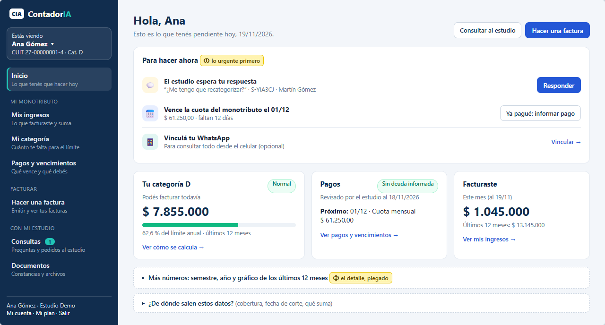

### Estudio

| Grupo | Nombre nuevo (antes) | Descripción corta |
|---|---|---|
| — | **Hoy** (Backoffice), y es donde entra al ingresar | Lo que el estudio tiene que atender |
| Clientes | **Contribuyentes** (la tabla del Backoffice + "Administrar") | Ficha, categoría, deudas, archivos |
| | **Consultas** (Bandeja) + número sin asignar | Bandeja de pedidos de clientes |
| | **Documentos** | Todos los archivos del estudio |
| | **Pedidos de acceso** (parte de Accesos) + número pendiente | Aprobar o rechazar CUIT |
| Configuración del estudio | **Usuarios** (parte de Accesos) | Claves, suspensiones, plan de cada uno |
| | **Planes** | Qué módulos ve cada cliente |
| | **Escalas** | Límites por categoría y vigencia |

Las pantallas "del cliente" (Movimientos, Categoría, Deudas, Facturación) **salen del menú del estudio**: se abren desde la ficha de cada contribuyente con "Ver como el cliente".

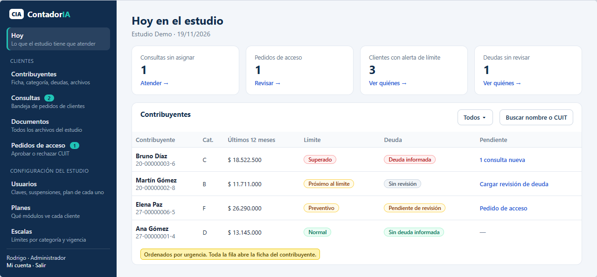

### Celular

- Barra inferior fija con lo más usado: **Inicio · Facturar · Mi categoría · Consultas · Más** (los ítems que el plan no incluye no aparecen).
- "Más" abre el menú completo **con los mismos grupos y descripciones** que en escritorio (en una columna).
- El "Estás viendo: Ana Gómez ▾" queda en la barra de arriba.

| Inicio en celular | Menú en celular |
|---|---|
| 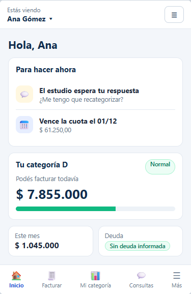 | 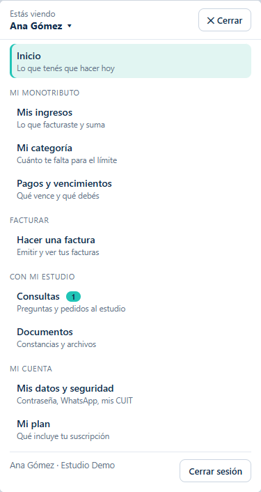 |

---

## 4. Inicio como "qué tengo que hacer ahora"

### Cliente

Orden, de arriba hacia abajo:

1. **Saludo + 2 botones**: "Hacer una factura" (principal) y "Consultar al estudio".
2. **Para hacer ahora**: una lista corta, lo más urgente primero, cada ítem con su botón. Se arma solo con datos que ya existen:
   - consulta "Esperando respuesta del cliente" (de **cualquiera** de sus CUIT) → *Responder*;
   - límite superado o próximo → *Consultar al estudio* (abre una consulta con el tema "Categoría y límites" ya elegido);
   - deuda informada por el estudio → *Ver deuda*;
   - vencimiento en los próximos 15 días → *Ya pagué: informar pago*;
   - falta la fecha de inicio de actividad → el mismo formulario de hoy;
   - correo sin confirmar, WhatsApp sin vincular, contraseña temporal (los "pasos" que hoy están en Mi perfil).
   - Si no hay nada: "No tenés nada pendiente". **Nunca "Estás al día con tus deudas"** salvo que haya revisión del estudio (la regla de `DebtReview` no cambia).
3. **Tres tarjetas resumen**: *Tu categoría* (cuánto podés facturar + barra), *Pagos* (estado de deuda + próximo vencimiento), *Facturaste* (este mes y últimos 12 meses). Cada una con un solo enlace a su sección.
4. **"Más números"** (plegado): las 4 tarjetas de período y el gráfico mensual, como hoy.
5. **"¿De dónde salen estos datos?"** (plegado): fecha de corte, cobertura, qué suma y qué no. Reemplaza las insignias y la nota técnica del pie.

La explicación completa del cálculo del límite queda **solo en "Mi categoría"**. Las tarjetas que el plan no incluye no se muestran (resuelve M12).

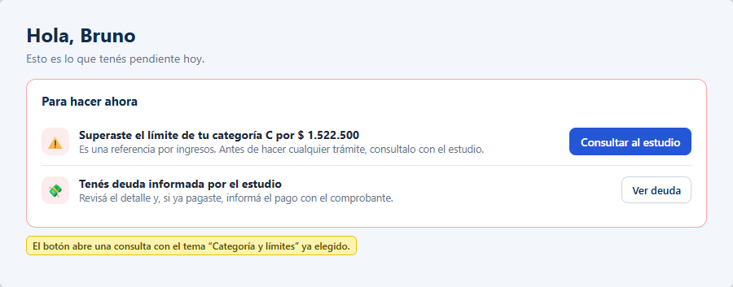

### Estudio ("Hoy")

1. **Cuatro tarjetas que llevan a algo**: consultas sin asignar → Consultas filtradas; pedidos de acceso → Pedidos de acceso; clientes con alerta de límite → la tabla filtrada; deudas sin revisión → la tabla filtrada.
2. **Tabla de contribuyentes ordenada por urgencia** (superado y deuda informada primero), con búsqueda por nombre o CUIT, una columna "Pendiente" (consulta nueva, pedido de acceso, revisión de deuda vieja) y **toda la fila abre la ficha**.
3. **Actividad reciente** sin los "Ingresó" (se pueden ver con un filtro).

---

## 5. Patrón común para todas las pantallas

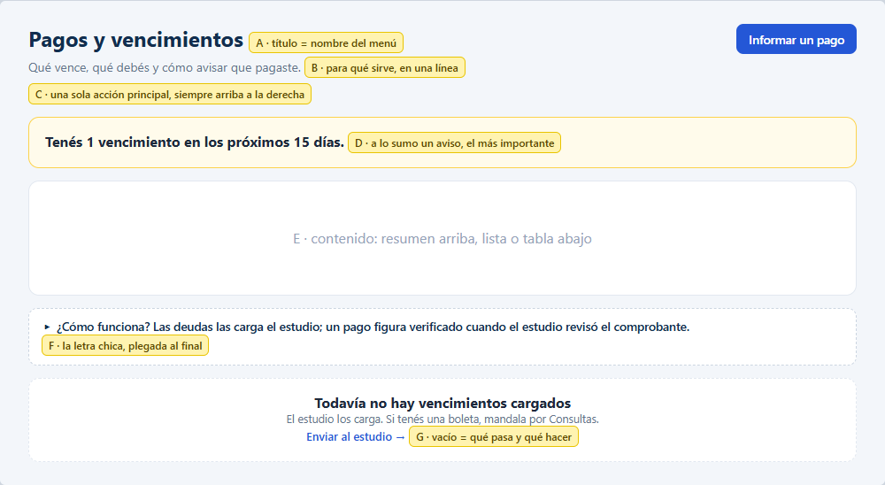

| | Regla |
|---|---|
| A | El título es igual al nombre del menú. |
| B | Debajo, una línea que dice para qué sirve la pantalla. |
| C | Una sola acción principal (botón azul), siempre arriba a la derecha. Las demás, como botón secundario o enlace. |
| D | A lo sumo **un** aviso arriba, el más importante (amarillo = atención, rojo = problema). |
| E | Contenido: primero el resumen, después la lista o tabla. |
| F | La letra chica (cómo se calcula, de dónde sale, sin ARCA) va al final, en un "¿Cómo funciona?" plegable. El aviso de "sin ARCA / sin validez fiscal" queda en el banner de arriba y en el paso de emitir, no en cada pantalla. |
| G | Pantalla vacía = qué pasa + qué hacer ("Todavía no hay vencimientos cargados. El estudio los carga. ¿Tenés una boleta? Enviala por Consultas"). Sin filtros cuando no hay nada que filtrar. |

Además: mismos nombres en todos lados (Consultas, Pagos y vencimientos, Mi categoría), estados sin abreviar y textos importantes en tamaño normal, no en gris de 12 px.

---

## 6. Cambios por pantalla

### Cliente

| Pantalla | Cambios |
|---|---|
| **Ingreso** | Sin cambios de fondo. Mantener "Correo, CUIT o DNI". |
| **Registro** | Corregir el texto: un CUIT nuevo se ve enseguida; si el CUIT ya es de otro cliente, lo confirma el estudio (M13). |
| **Inicio** | Ver sección 4. |
| **Mis ingresos** (Movimientos) | Arriba, 3 números: total que suma, cantidad de comprobantes, período. Quitar la columna "Origen" cuando todas las filas dicen lo mismo (o mostrarla como etiqueta solo si difiere). Accesos rápidos de período ("Este mes · Semestre · Últimos 12 meses") además de Desde/Hasta. Enlace "¿Querés hacer una factura?". |
| **Mi categoría** | Es la única pantalla con la explicación completa. Orden: margen (grande) → categoría registrada → orientativa (con su aviso) → "Cómo se calcula" → escala (plegada). Botón "Consultar al estudio sobre mi categoría". |
| **Pagos y vencimientos** (Deudas) | Acción principal "Informar un pago". Lista agrupada: *Vencidas · Próximas · Pagadas*. La aclaración de ARCA al "¿Cómo funciona?". |
| **Hacer una factura** (Facturación) | Si no hay facturas hechas en la web: un vacío que explique "Acá ves las facturas que hacés desde ContadorIA. Lo que cargó el estudio está en **Mis ingresos**" + botón (A3). Filtros solo cuando hay facturas. |
| **Consultas** (Solicitudes) | Mostrar arriba, destacadas, las que esperan tu respuesta. Unificar nombre. "Nueva consulta" acepta el tema desde el enlace (para los botones de Inicio y Mi categoría). |
| **Documentos** | Sin el filtro de contribuyente cuando hay uno solo; el de "Categoría" pasa a pestañas simples si hay pocos archivos. |
| **Mis datos y seguridad** (Mi perfil) | Se divide en pestañas: *Mis datos* (nombre, teléfono, contraseña) · *WhatsApp* · *Mis CUIT* (contribuyentes + asociar otro). La lista de "pasos" pasa a Inicio ("Para hacer ahora"). Se quita "Vinculación fiscal" (repetía "Conexión con ARCA"). "Necesito ayuda / Solicitar una llamada" pasa a un botón "Ayuda" fijo en el menú. |
| **Mi plan** | Sin cambios de fondo; agregar "¿Querés sumar un módulo? Consultá al estudio". |

### Estudio

| Pantalla | Cambios |
|---|---|
| **Hoy** (Backoffice) | Ver sección 4. Es la pantalla de entrada del administrador. |
| **Ficha del contribuyente** | Pestañas: *Resumen* (lo que necesita atención + datos clave) · *Comprobantes* (cargar manual + últimos) · *Categoría* (registrar + historial + cobertura) · *Deudas y vencimientos* (cargar, actualizar, revisión) · *Documentos* · *Consultas* · *Accesos*. Botón "Ver como el cliente". |
| **Consultas** (Bandeja) | Una fila de pestañas: *Para atender · Esperando al cliente · Resueltas · Todas* y un interruptor "Solo las mías". Búsqueda (ya está en el backlog). |
| **Pedidos de acceso** | Solo los pedidos, con "Aprobar / Rechazar" en la tarjeta y los datos declarados al lado de los del sistema. |
| **Usuarios** | Tabla de usuarios con estado, WhatsApp y plan; acciones (blanquear clave, suspender, cambiar plan, revocar un acceso) en un menú "⋯" por fila. |
| **Planes** | "Lo usan N clientes" contando también a los que tienen el plan por defecto (M6). Enlace a Usuarios para asignar. |
| **Escalas** | El formulario "Nueva versión" detrás de un botón (hoy ocupa media página aunque casi nunca se use). |

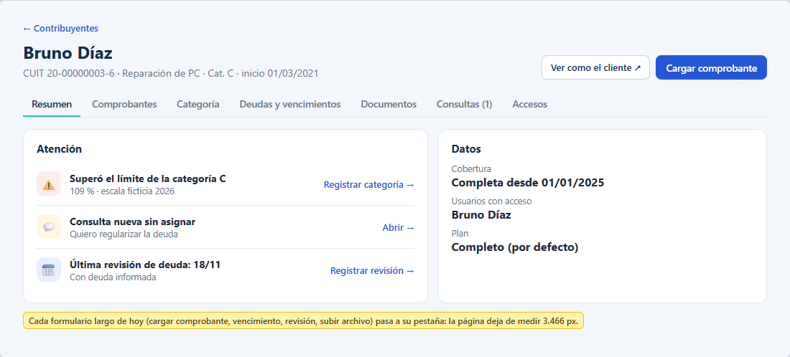

---

## 7. Antes (capturas)

| Pantalla | Escritorio |
|---|---|
| Inicio cliente | 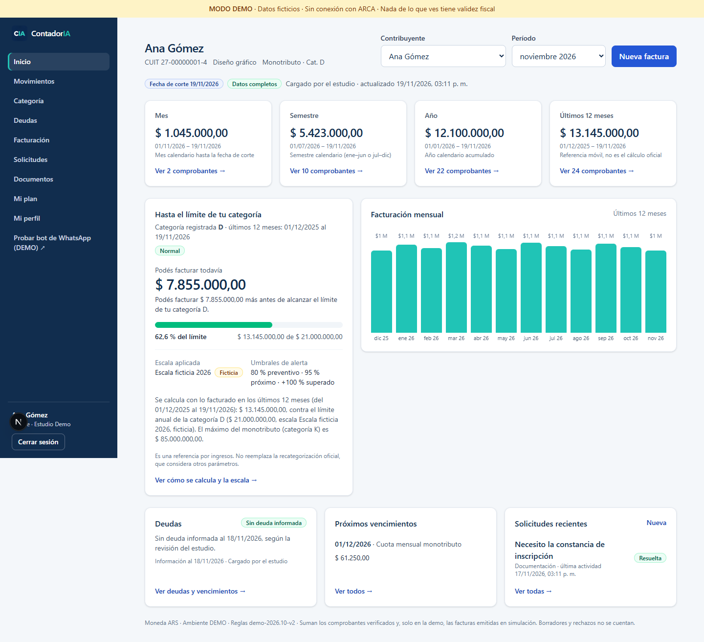 |
| Inicio con límite superado (sin botón para actuar) | 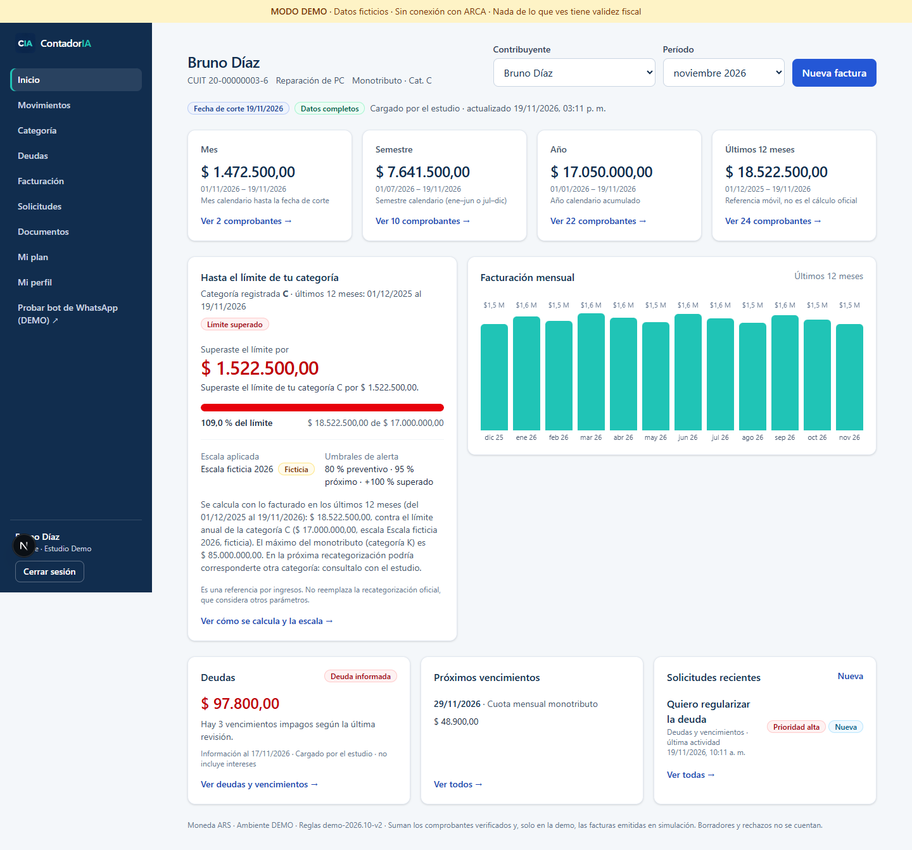 |
| Movimientos (24 comprobantes) | 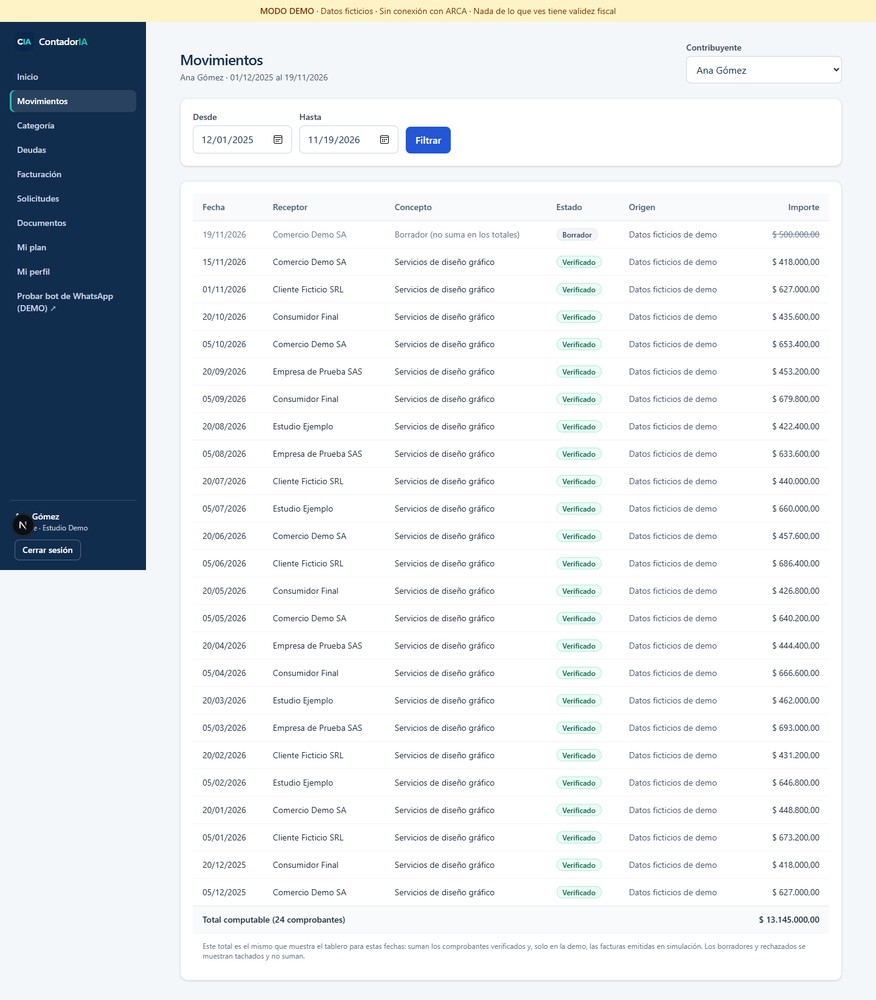 |
| Facturación del mismo cliente ("no hiciste ninguna factura") | 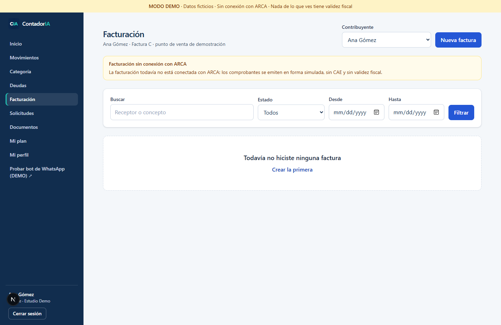 |
| Categoría (repite la tarjeta de Inicio) | 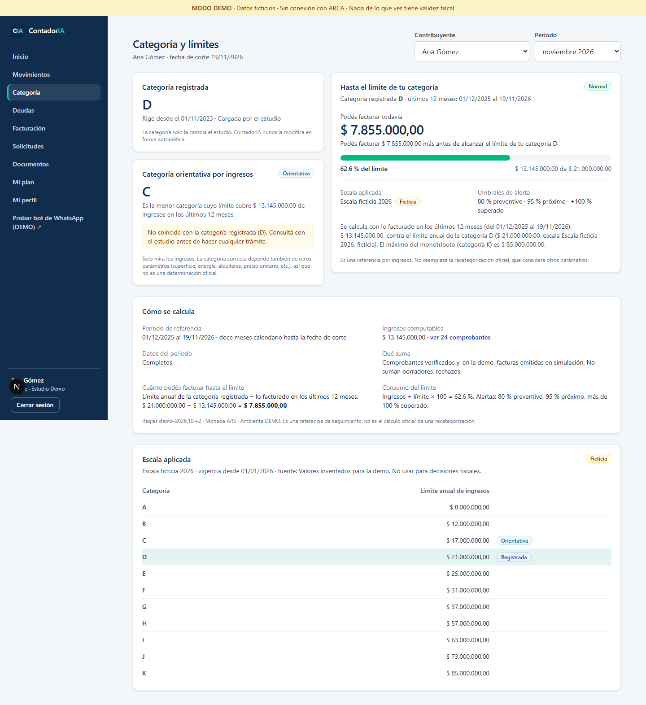 |
| Mi perfil (8 secciones) | 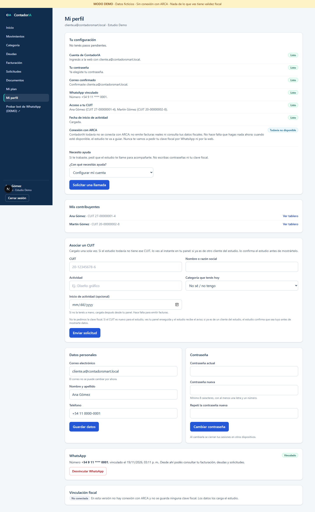 |
| Inicio del estudio (tablero de un cliente) | 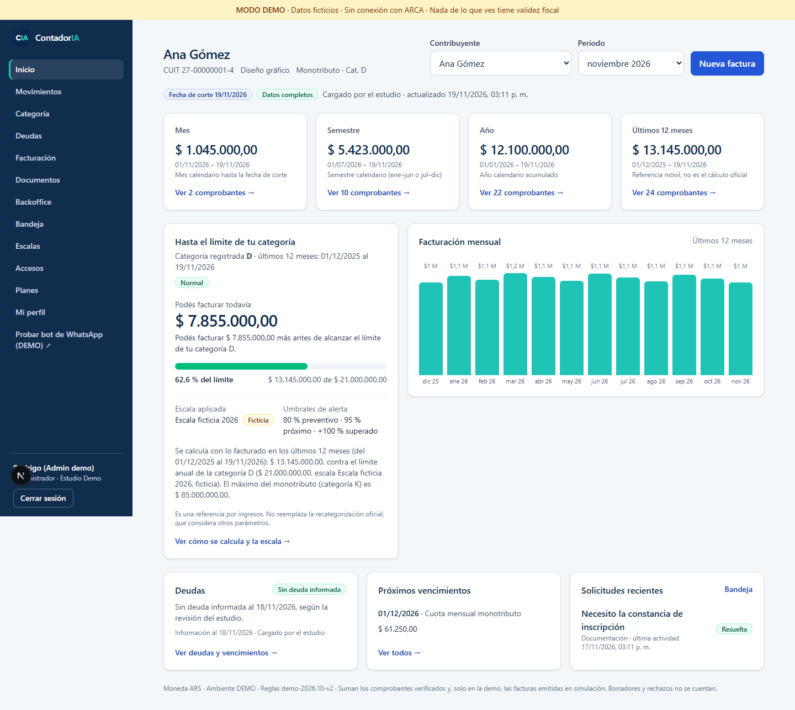 |
| Backoffice | 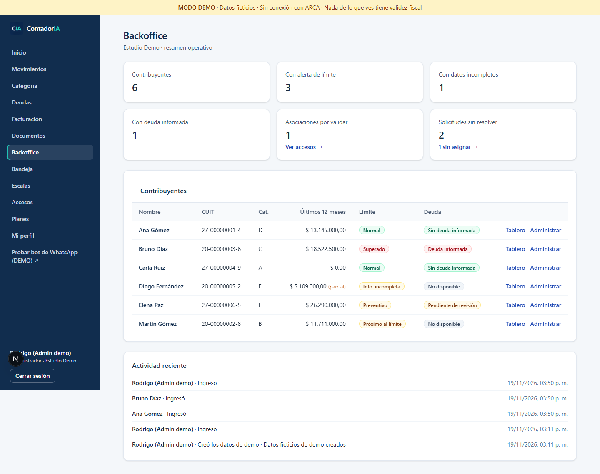 |
| Bandeja | 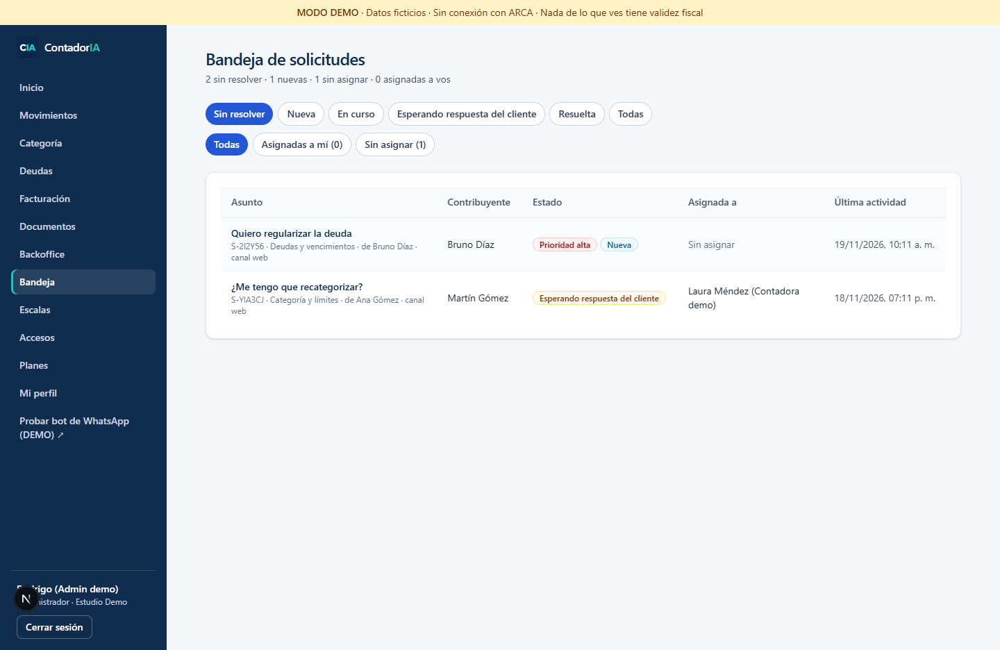 |
| Accesos | 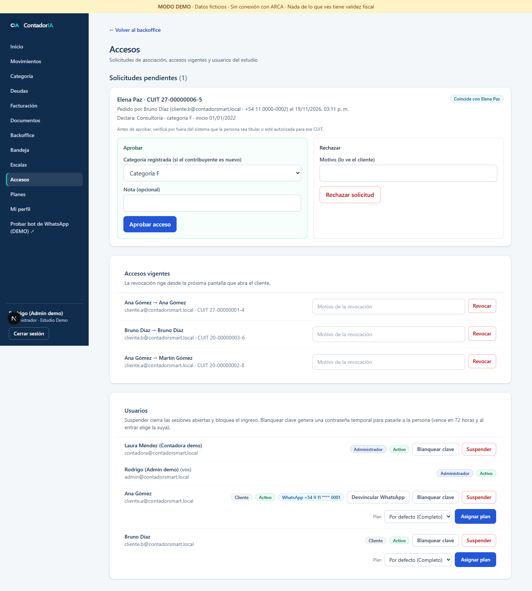 |
| Ficha del contribuyente (3.466 px) | 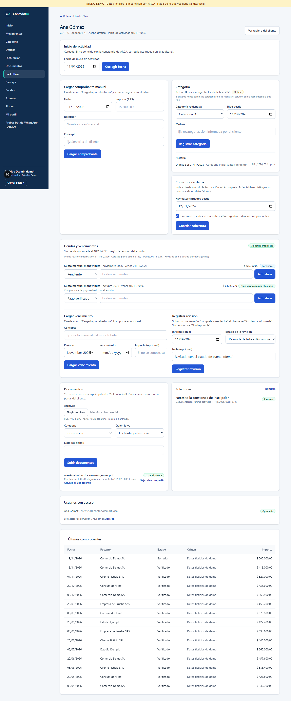 |

| Inicio en celular (3.086 px) | Menú en celular |
|---|---|
| 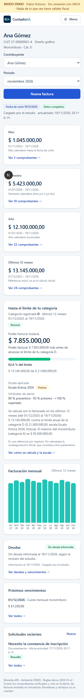 | 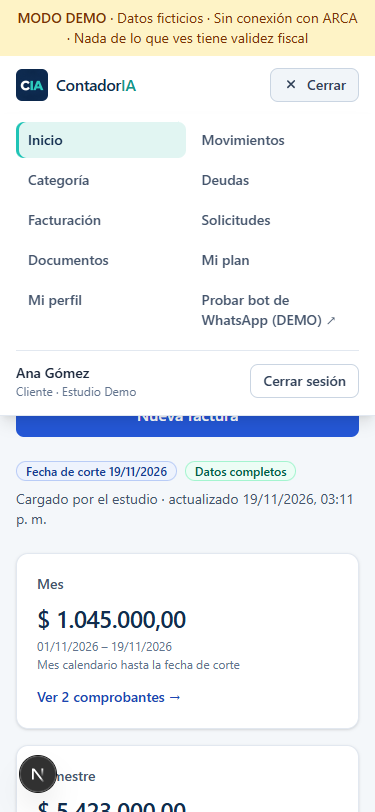 |

---

## 8. Cómo implementarlo (por partes, cuando se apruebe)

Cada parte se puede probar y publicar sola, con `npm run typecheck`, `npm run verify` y `npm run test:e2e`, más capturas de antes y después.

| Parte | Qué incluye | Riesgo |
|---|---|---|
| **1. Menú y nombres** | Menú agrupado con descripciones (escritorio y celular), nombres nuevos, títulos iguales al menú, el estudio entra a "Hoy" y deja de ver las pantallas del cliente en el menú, textos de Registro y Facturación vacía. | Bajo: no cambia ninguna pantalla por dentro. Hay que actualizar las pruebas que buscan los nombres viejos. |
| **2. Inicio del cliente** | "Para hacer ahora", 3 tarjetas, detalle plegado, respeta el plan, botón de consulta con tema elegido. | Medio: usa datos que ya existen (consultas, deudas, margen, perfil). |
| **3. Patrón de pantalla y contribuyente elegido** | "Estás viendo" global, letra chica plegada, vacíos con acción, en Mis ingresos, Mi categoría, Pagos, Facturar, Consultas y Documentos. | Medio. |
| **4. Estudio** | "Hoy" con tarjetas que filtran y tabla por urgencia; ficha con pestañas; Accesos dividido en Pedidos de acceso y Usuarios; Bandeja simplificada; Planes con el conteo correcto. | Medio-alto: son las pantallas con más formularios. |
| **5. Mi cuenta y celular** | Mi perfil en pestañas, barra inferior en celular, ayuda fija. | Medio. |

## 9. Decisiones para el usuario

1. **¿Aprobás la propuesta en general?** Si sí, se empieza por la parte 1.
2. **Nombres**: ¿"Consultas" o seguir con "Solicitudes"? ¿"Mis ingresos" o "Movimientos"? ¿"Pagos y vencimientos" o "Deudas"?
3. **Estudio**: ¿está bien que las pantallas del cliente salgan del menú del estudio y se abran desde cada ficha ("Ver como el cliente")?
4. **Celular**: ¿barra inferior fija (como las apps de bancos) o solo el botón "Menú" de hoy, pero con grupos?
